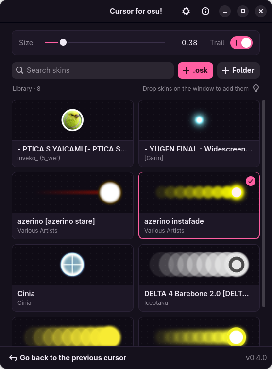
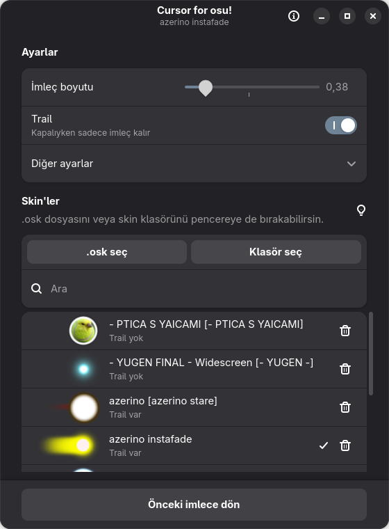

# Cursor for osu!

<p align="center">
  
</p>

[English](#english) · [Türkçe](#türkçe)

## English

### Windows 11 x64

Extract the portable ZIP and run `CursorForOsu.exe`. Pick a `.osk` file or skin folder,
or drop it on the window. Select its card to apply it. The **Trail** switch controls
the desktop trail. Use **Trail density** (50–400%) to space the trail stamps.
Closing the window keeps the trail running in the background.
Use the Cursor for osu! icon in the Windows notification area to reopen the window or
quit the app. Quitting stops the trail and keeps the skin cursor for the Windows session.
Use **Go back to the previous cursor** to reload your Windows pointer scheme.

To run or package from source on Windows with 64-bit Python 3.11:

```powershell
python -m venv .venv
.\.venv\Scripts\python.exe -m pip install -r packaging/windows/requirements.txt
.\.venv\Scripts\python.exe -m osu_cursor
.\.venv\Scripts\python.exe packaging/windows/build.py
```

The ZIP is written to `build/windows/CursorForOsu-windows-x64.zip`. Skin copies and
preferences are saved in `%LOCALAPPDATA%\CursorForOsu`.

Use the cursor and cursor trail of your osu! skins on GNOME or KDE Plasma, outside the game.

<p align="center">
  
</p>

KDE Plasma support by [@MehmetAkifUgur](https://github.com/MehmetAkifUgur).

Cursor for osu! is a fan-made tool. It is not made by or affiliated with ppy or osu!.

### Before you start

You type the install commands into a terminal. Open it from your applications: it is called
**Terminal** or **Console** on GNOME and **Konsole** on KDE Plasma. Copy a command, paste it
with **Ctrl+Shift+V** and press **Enter**. Commands that start with `sudo` ask for your password.
Nothing appears on the screen while you type it, that is normal, type it and press **Enter**.

Not sure which desktop you have? Run `echo $XDG_CURRENT_DESKTOP` in the terminal. It prints
`GNOME` or `KDE`.

### Installation on GNOME

You need GNOME on Wayland. The trail is made for GNOME Shell 51, the cursor works on any GNOME.

1. Install the packages the app needs. Pick the line for your distribution:

   ```sh
   # Arch, CachyOS, Manjaro
   sudo pacman -S --needed git python python-pillow python-gobject libadwaita
   ```

   ```sh
   # Ubuntu, Debian
   sudo apt install git python3 python3-pil python3-gi gir1.2-adw-1
   ```

   ```sh
   # Fedora
   sudo dnf install git python3 python3-pillow python3-gobject libadwaita
   ```

   ```sh
   # openSUSE
   sudo zypper install git python3 python3-Pillow python3-gobject typelib-1_0-Adw-1
   ```

2. Download and install the app:

   ```sh
   git clone https://github.com/egehankara/cursor-for-osu.git
   cd cursor-for-osu
   bash install.sh
   ```

3. Log out and log back in once, so GNOME loads the trail.
4. Open **Cursor for osu!** from your applications and pick a skin.

### Installation on KDE Plasma

You need KDE Plasma 6.6 or newer on Wayland. On Plasma the trail is a small add-on for KWin,
Plasma's window manager, that the commands in step 3 build on your computer.

1. Install the packages the app and the trail need. Pick the line for your distribution:

   ```sh
   # Arch, CachyOS, Manjaro
   sudo pacman -S --needed git python python-pillow python-gobject libadwaita plasma-workspace libkscreen kwin extra-cmake-modules cmake base-devel vulkan-headers
   ```

   ```sh
   # Kubuntu
   sudo apt install git python3 python3-pil python3-gi gir1.2-adw-1 plasma-workspace libkscreen-bin kwin-dev extra-cmake-modules cmake g++ pkgconf libwayland-dev libdrm-dev
   ```

2. Download and install the app:

   ```sh
   git clone https://github.com/egehankara/cursor-for-osu.git
   cd cursor-for-osu
   bash install.sh
   ```

3. Build and install the trail, in the same terminal:

   ```sh
   # Arch, CachyOS, Manjaro
   cmake -S kwin -B build -DKDE_INSTALL_PLUGINDIR="$(/usr/lib/qt6/bin/qtpaths6 --query QT_INSTALL_PLUGINS)"
   cmake --build build
   sudo cmake --install build
   ```

   ```sh
   # Kubuntu
   cmake -S kwin -B build -DKDE_INSTALL_PLUGINDIR="$(qtpaths6 --query QT_INSTALL_PLUGINS)"
   cmake --build build
   sudo cmake --install build
   ```

4. Log out and log back in once.
5. Open **System Settings**, go to **Desktop Effects** and turn on **Cursor for osu! Trail**.
6. Open **Cursor for osu!** from your applications and pick a skin.

The cursor also works with the trail turned off. The trail was tested on CachyOS with Plasma 6
and builds with KWin 6.6 up to 6.8.

### Updating

The app asks GitHub once a day whether a new version is out. If one is, a bar at the top of the
window says so, and **How to update** shows the commands below with your folder filled in. If you
pick **Not now**, it asks whether to tell you about later versions. Answer **No** and it stops
checking; the About window can turn it back on.

To update, open a terminal and run:

```sh
cd cursor-for-osu
git pull
bash install.sh
```

On KDE Plasma, also run the three commands of step 3 again and log out and back in once. Run
them again after every Plasma update too.

### Uninstalling

```sh
cursor-for-osu uninstall               # or: bash uninstall.sh
cursor-for-osu uninstall --keep-data   # keep the skin list and settings for a later install
```

This puts your previous cursor back, turns the trail extension off and removes the app,
the extension and the cursor themes it made. The skin files you added from are never touched.

On Plasma, run the uninstall command from the Plasma Wayland session. To remove the separately
installed module, disable **Cursor for osu! Trail** in Desktop Effects and remove the module.

```sh
# Kubuntu:
sudo rm -- "$(qtpaths6 --query QT_INSTALL_PLUGINS)/kwin/effects/plugins/osu-cursor-trail.so"
# Arch, CachyOS, Manjaro:
sudo rm -- "$(/usr/lib/qt6/bin/qtpaths6 --query QT_INSTALL_PLUGINS)/kwin/effects/plugins/osu-cursor-trail.so"
```

### Languages

The app follows your desktop language. It is translated into English, Türkçe, Español,
Português (Brasil), Deutsch, Français, Русский, Polski, 日本語 and 简体中文.
To start it in another language: `LANGUAGE=de cursor-for-osu`.
The translations are in `osu_cursor/locale/`, one JSON file per language that maps the English text
to the translated one. `python3 -m pytest` checks that every text has a translation.

### Usage

Open **Cursor for osu!** from your applications and add skins with the **.osk** and **Folder** buttons (for an unpacked skin folder), or drop `.osk` files and skin folders on the window. Each skin gets a card with its cursor and trail, its name and its author. Click a card to apply the skin, the one in use has a pink frame. Set the size with the slider, or click the number next to it and type one.

Skins you export from osu!lazer are added on their own, the app watches the game's exports folder while it is open and catches up on new exports when it starts. A skin you remove from the list doesn't come back unless you export it again. This can be turned off with the **Watch osu! exports** switch under **More settings**, the gear button at the top. The **Add all** button next to it adds every export at once, removed skins included. If osu!lazer keeps its files somewhere the app doesn't look, pick the folder with **Change** next to **osu!lazer folder**. Right-click a card to rename the skin, open its folder or remove it. Removing the skin in use goes back to your previous cursor.

From the command line:

```sh
cursor-for-osu apply skin.osk        # apply a skin
cursor-for-osu size 1.2              # cursor size, 0.1 to 2.0 like in the game
cursor-for-osu reset                 # go back to the previous cursor
cursor-for-osu status
cursor-for-osu uninstall
```

### How it works

- The cursor becomes an Xcursor theme generated from the skin, so the low-latency hardware cursor is used.
  Its size matches the game. It is set with the slider in the app, or read from osu!lazer if you haven't set it. The game's Screen Scaling setting is taken into account too.
- Every cursor shape shows the skin cursor. With **Keep system cursors** on, the text, resize, move, not-allowed and crosshair cursors come from the cursor theme you used before, coloured like the skin cursor: their dark parts take a dark shade of its colour and their light parts a light shade, so they stay visible on any background. The trail is not drawn behind them.
- Each added skin is kept in its own folder under `~/.local/share/osu-cursor/skins`. Only the cursor files (`cursor`, `cursormiddle`, `cursortrail`, with their `@2x` versions) and `skin.ini` are copied.
- The GNOME Shell extension in `extension/` and the KWin effect in `kwin/` draw the trail. Fade times, part spacing and blending come from osu!lazer's `CursorTrail` and `LegacyCursorTrail`.
- The trail turns off over fullscreen windows and while an application hides the cursor.

Growing the cursor on click (`CursorExpand`) is not supported, because a cursor theme can't react to clicks.
Spinning skins (`CursorRotate`) are shown still, because animated cursors on GNOME stall when switching skins and jump when the cursor shape changes.

### License

Cursor for osu! is released under the [MIT License](LICENSE). The trail behaviour is adapted from the MIT licensed [osu!](https://github.com/ppy/osu) code
(Copyright (c) ppy Pty Ltd), its notice is in [THIRD-PARTY-NOTICES](THIRD-PARTY-NOTICES). Skin images must not be added to this repository, they belong to their creators.

### Tests

```sh
python3 -m pytest
ctest --test-dir build --output-on-failure   # KWin trail, after building it
```

See [CONTRIBUTING.md](CONTRIBUTING.md) for how to work on the app.

## Türkçe

### Windows 11 x64

Taşınabilir ZIP’i aç ve `CursorForOsu.exe` dosyasını çalıştır. `.osk` dosyasını veya
skin klasörünü seç ya da pencereye sürükle. Uygulamak için skin kartına tıkla.
**Trail** ayarı masaüstündeki izi açıp kapatır. **İz yoğunluğu** ile iz parçalarının sıklığını
%50 ile %400 arasında ayarlayabilirsin. Pencereyi kapattığında iz arka planda
çalışmaya devam eder. Pencereyi geri açmak veya uygulamadan çıkmak için Windows bildirim
alanındaki Cursor for osu! simgesini kullan. Uygulamadan çıkınca iz durur ve skin imleci
Windows oturumunda kalır. Windows imleç şemana dönmek için **Önceki imlece dön** düğmesini kullan.

64 bit Python 3.11 ile kaynaktan çalıştırmak ve paketlemek için PowerShell’de şu komutları çalıştır.

```powershell
python -m venv .venv
.\.venv\Scripts\python.exe -m pip install -r packaging/windows/requirements.txt
.\.venv\Scripts\python.exe -m osu_cursor
.\.venv\Scripts\python.exe packaging/windows/build.py
```

ZIP dosyası `build/windows/CursorForOsu-windows-x64.zip` yoluna oluşturulur.
Skin kopyaları ve ayarlar `%LOCALAPPDATA%\CursorForOsu` altında saklanır.

osu! skin'lerindeki imleci ve trail'i oyun dışında GNOME ve KDE Plasma'da kullanır.

<p align="center">
  
</p>

KDE Plasma desteği: [@MehmetAkifUgur](https://github.com/MehmetAkifUgur).

Cursor for osu! hayran yapımı bir araçtır. ppy veya osu! tarafından yapılmamıştır ve onlarla bağlantılı değildir.

### Başlamadan önce

Kurulum komutlarını bir terminale yazarsın. Terminali uygulamalarından aç: GNOME'da adı
**Terminal** veya **Konsol**, KDE Plasma'da **Konsole**. Bir komutu kopyala, **Ctrl+Shift+V** ile
yapıştır ve **Enter**'a bas. `sudo` ile başlayan komutlar şifreni sorar. Şifreni yazarken ekranda
hiçbir şey görünmez, bu normal, yaz ve **Enter**'a bas.

Hangi masaüstünü kullandığından emin değil misin? Terminalde `echo $XDG_CURRENT_DESKTOP` çalıştır.
`GNOME` veya `KDE` yazar.

### GNOME'da kurulum

GNOME'un Wayland oturumu gerekir. Trail GNOME Shell 51 için yapıldı, imleç her GNOME'da çalışır.

1. Uygulamanın ihtiyaç duyduğu paketleri kur. Dağıtımına uygun satırı seç:

   ```sh
   # Arch, CachyOS, Manjaro
   sudo pacman -S --needed git python python-pillow python-gobject libadwaita
   ```

   ```sh
   # Ubuntu, Debian
   sudo apt install git python3 python3-pil python3-gi gir1.2-adw-1
   ```

   ```sh
   # Fedora
   sudo dnf install git python3 python3-pillow python3-gobject libadwaita
   ```

   ```sh
   # openSUSE
   sudo zypper install git python3 python3-Pillow python3-gobject typelib-1_0-Adw-1
   ```

2. Uygulamayı indir ve kur:

   ```sh
   git clone https://github.com/egehankara/cursor-for-osu.git
   cd cursor-for-osu
   bash install.sh
   ```

3. Bir kez oturumu kapatıp tekrar aç, GNOME trail'i böyle yükler.
4. Uygulamalarından **Cursor for osu!**'yu aç ve bir skin seç.

### KDE Plasma'da kurulum

KDE Plasma 6.6 veya daha yenisi ve Wayland oturumu gerekir. Plasma'da trail, Plasma'nın pencere
yöneticisi KWin için küçük bir eklentidir ve 3. adımdaki komutlar onu senin bilgisayarında derler.

1. Uygulamanın ve trail'in ihtiyaç duyduğu paketleri kur. Dağıtımına uygun satırı seç:

   ```sh
   # Arch, CachyOS, Manjaro
   sudo pacman -S --needed git python python-pillow python-gobject libadwaita plasma-workspace libkscreen kwin extra-cmake-modules cmake base-devel vulkan-headers
   ```

   ```sh
   # Kubuntu
   sudo apt install git python3 python3-pil python3-gi gir1.2-adw-1 plasma-workspace libkscreen-bin kwin-dev extra-cmake-modules cmake g++ pkgconf libwayland-dev libdrm-dev
   ```

2. Uygulamayı indir ve kur:

   ```sh
   git clone https://github.com/egehankara/cursor-for-osu.git
   cd cursor-for-osu
   bash install.sh
   ```

3. Aynı terminalde trail'i derle ve kur:

   ```sh
   # Arch, CachyOS, Manjaro
   cmake -S kwin -B build -DKDE_INSTALL_PLUGINDIR="$(/usr/lib/qt6/bin/qtpaths6 --query QT_INSTALL_PLUGINS)"
   cmake --build build
   sudo cmake --install build
   ```

   ```sh
   # Kubuntu
   cmake -S kwin -B build -DKDE_INSTALL_PLUGINDIR="$(qtpaths6 --query QT_INSTALL_PLUGINS)"
   cmake --build build
   sudo cmake --install build
   ```

4. Bir kez oturumu kapatıp tekrar aç.
5. **Sistem Ayarları**'nı aç, **Masaüstü Efektleri**'ne gir ve **osu! İmleç İzi**'ni aç.
6. Uygulamalarından **Cursor for osu!**'yu aç ve bir skin seç.

Trail kapalıyken de imleç çalışır. Trail CachyOS'ta Plasma 6 ile test edildi ve KWin 6.6'dan
6.8'e kadar derlenir.

### Güncelleme

Uygulama yeni sürüm çıkıp çıkmadığını günde bir kez GitHub'a sorar. Çıktıysa pencerenin üstünde
bir şerit belirir, **Nasıl güncellenir?** düğmesi de aşağıdaki komutları senin klasörünle birlikte
gösterir. **Şimdi değil** dersen sonraki sürümlerde haber verip vermeyeceğini sorar. **Hayır**
dersen kontrolü bırakır, Hakkında penceresinden tekrar açabilirsin.

Güncellemek için bir terminal aç ve şunu çalıştır:

```sh
cd cursor-for-osu
git pull
bash install.sh
```

KDE Plasma'da 3. adımdaki üç komutu da tekrar çalıştır ve bir kez oturumu kapatıp aç. Her Plasma güncellemesinden sonra da bu komutları yeniden çalıştır.

### Kaldırma

```sh
cursor-for-osu uninstall               # veya: bash uninstall.sh
cursor-for-osu uninstall --keep-data   # skin listesini ve ayarları sonraki kurulum için sakla
```

Önceki imlecini geri getirir, trail eklentisini kapatır, uygulamayı, eklentiyi ve oluşturduğu
imleç temalarını siler. Skin eklerken seçtiğin dosyalara hiçbir zaman dokunulmaz.

Plasma'da kaldırma komutunu Plasma Wayland oturumunda çalıştır. Ayrı kurulan KWin modülünü
kaldırmak için Masaüstü Efektleri'nden **osu! İmleç İzi** efektini kapat ve modülü sil.

```sh
# Kubuntu:
sudo rm -- "$(qtpaths6 --query QT_INSTALL_PLUGINS)/kwin/effects/plugins/osu-cursor-trail.so"
# Arch, CachyOS, Manjaro:
sudo rm -- "$(/usr/lib/qt6/bin/qtpaths6 --query QT_INSTALL_PLUGINS)/kwin/effects/plugins/osu-cursor-trail.so"
```

### Diller

Uygulama masaüstünün dilini kullanır. English, Türkçe, Español, Português (Brasil), Deutsch,
Français, Русский, Polski, 日本語 ve 简体中文 dillerine çevrilmiştir.
Başka bir dilde açmak için: `LANGUAGE=de cursor-for-osu`.
Çeviriler `osu_cursor/locale/` altında, her dil için İngilizce metni çevirisiyle eşleyen bir JSON dosyasıdır.
`python3 -m pytest` her metnin çevrildiğini kontrol eder.

### Kullanım

Uygulamalardan **Cursor for osu!**'i aç, **.osk** ve **Klasör** düğmeleriyle ya da pencereye sürükleyerek `.osk` dosyalarını ve skin klasörlerini ekle. Her skin, imleci ve trail'i, adı ve yapımcısıyla bir kart olarak görünür. Uygulamak için bir karta tıkla, kullandığın skin pembe çerçeveli olur. Boyutu kaydırıcıyla ayarlayabilir ya da yanındaki sayıya tıklayıp yazabilirsin.

osu!lazer'dan export ettiğin skin'ler kendiliğinden eklenir: uygulama açıkken oyunun exports klasörünü izler, açılınca da kapalıyken yapılan export'ları ekler. Listeden kaldırdığın bir skin, tekrar export etmedikçe geri gelmez. Bunu üstteki ⚙ düğmesiyle açılan **Diğer ayarlar** altındaki **osu! export'larını izle** anahtarıyla kapatabilirsin. Yanındaki **Tümünü ekle** düğmesi, kaldırdıkların dahil bütün export'ları bir kerede ekler. osu!lazer dosyalarını uygulamanın bakmadığı bir yerde tutuyorsa, **osu!lazer klasörü** satırındaki **Değiştir** ile klasörü seçebilirsin. Bir karta sağ tıklayarak skin'in adını değiştirebilir, klasörünü açabilir veya onu kaldırabilirsin. Kullandığın skini kaldırınca önceki imlecine dönersin.

Komut satırından:

```sh
cursor-for-osu apply skin.osk        # skin'i uygula
cursor-for-osu size 1.2              # imleç boyutu, oyundaki gibi 0.1 ile 2.0 arası
cursor-for-osu reset                 # önceki imlece dön
cursor-for-osu status
cursor-for-osu uninstall
```

### Nasıl çalışır

- İmleç, skin'den üretilen bir Xcursor teması olur, böylece gecikmesiz donanım imleci kullanılır.
  Boyutu oyundakiyle aynıdır. Uygulamadaki kaydırıcıdan ayarlanır, ayarlanmadıysa osu!lazer'den okunur. Oyundaki ekran ölçekleme (Screen Scaling) ayarı da hesaba katılır.
- Bütün imleç şekilleri skin imlecini gösterir. **Sistem imleçlerini koru** açıksa yazı, boyutlandırma, taşıma, yasak ve artı imleçleri önceden kullandığın imleç temasından alınır ve skin imlecinin rengine boyanır: koyu kısımları o rengin koyu tonunu, açık kısımları açık tonunu alır, böylece her arka planda görünürler. Bunların arkasında trail çizilmez.
- Eklenen her skin `~/.local/share/osu-cursor/skins` altında kendi klasöründe tutulur. Sadece imleç dosyaları (`cursor`, `cursormiddle`, `cursortrail`, `@2x` sürümleriyle) ve `skin.ini` kopyalanır.
- Trail'i `extension/` altındaki GNOME Shell eklentisi ve `kwin/` altındaki KWin efekti çizer. Solma süreleri, parça aralığı ve karışım modu osu!lazer'in `CursorTrail` ve `LegacyCursorTrail` kodundan alınmıştır.
- Tam ekran pencerelerde ve bir uygulama imleci gizlediğinde trail kapanır.

Tıklayınca imlecin büyümesi (`CursorExpand`) desteklenmiyor, çünkü imleç teması tıklamaya tepki veremez.
Dönen skinler (`CursorRotate`) sabit gösterilir, çünkü GNOME'da animasyonlu imleçler skin değişiminde takılıyor ve imleç şekli değişince açısı atlıyor.

### Lisans

Cursor for osu! [MIT Lisansı](LICENSE) ile yayınlanır. Trail davranışı MIT lisanslı [osu!](https://github.com/ppy/osu) kodundan uyarlanmıştır
(Copyright (c) ppy Pty Ltd), lisans notu [THIRD-PARTY-NOTICES](THIRD-PARTY-NOTICES) dosyasındadır. Skin görselleri bu repoya konmamalıdır, hakları yapımcılarına aittir.

### Test

```sh
python3 -m pytest
ctest --test-dir build --output-on-failure   # KWin trail'i, derledikten sonra
```

Uygulama üzerinde nasıl çalışılacağı [CONTRIBUTING.md](CONTRIBUTING.md#türkçe) dosyasında.
