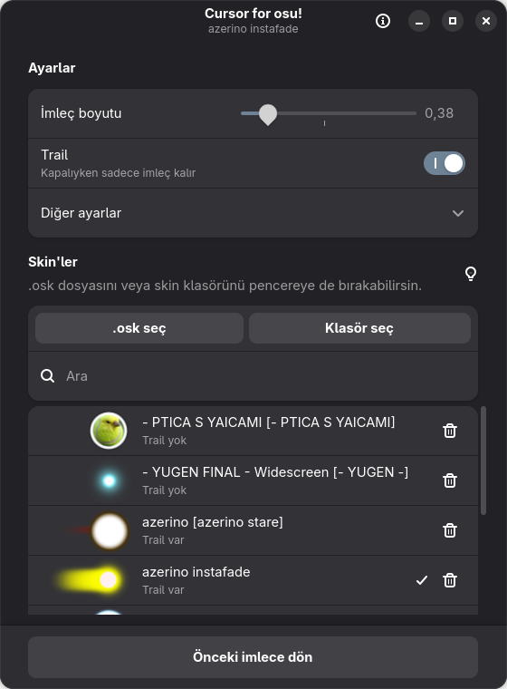

<div align="center">


# Cursor for osu!

**osu! skin'inin imleci ve trail'i, bütün Linux masaüstünde.**

GNOME · KDE Plasma · Wayland

[English](README.md) · **Türkçe**



</div>

Cursor for osu!, bir osu! skin'inin imlecini alır ve Linux masaüstünün her yerinde fare imlecin
yapar: tarayıcında, dosya yöneticinde, masaüstünün kendisinde. Arkasındaki **trail** de onunla
gelir, fareyi oynatınca oyundaki gibi hissettirir.

Skin'in `.osk` dosyasını ya da klasörünü uygulamaya ekle ve **üstüne tıkla, bu kadar**. Hiçbir şeyi
açman ya da çıkarman gerekmez. İmleç osu!lazer'deki boyutta olur, trail de oyundaki gibi solar.
osu!lazer'den export ettiğin skin'ler uygulamaya kendiliğinden gelir, aralarında geçiş yapmak tek
tıklama. osu!'nun açık olması, hatta kurulu olması bile gerekmez. Eski imlecini istediğinde tek bir
düğme onu geri getirir.

> [!IMPORTANT]
> **Sadece Linux.** **Wayland** üzerinde **GNOME 51** veya **KDE Plasma 6.6+** gerekir.
> Daha eski bir GNOME'da imleç yine çalışır, sadece trail çalışmaz.
>
> Neyi kullandığından emin değil misin? Terminalde şunları çalıştır:
> - `echo $XDG_CURRENT_DESKTOP` → `GNOME` veya `KDE` yazar.
> - `echo $XDG_SESSION_TYPE` → `wayland` yazar. `x11` yazıyorsa giriş ekranında Wayland oturumu seç.
> - `gnome-shell --version` veya `plasmashell --version` → sürümünü yazar.

## Kurulum

<details>
<summary><b>Terminale yeni misin?</b></summary>

GNOME'da **Terminal** veya **Konsol**, KDE Plasma'da **Konsole** uygulamasını aç. Bir komutu
kopyala, **Ctrl+Shift+V** ile yapıştır ve **Enter**'a bas. `sudo` ile başlayan komutlar şifreni
sorar, yazarken ekranda hiçbir şey görünmez. Bu normal.

</details>

### 1. Paketleri kur

Dağıtımını aç ve **sadece masaüstünün komutunu** çalıştır.

<details>
<summary><b>Arch, CachyOS, Manjaro</b></summary>

GNOME:

```sh
sudo pacman -S --needed git python python-pillow python-gobject libadwaita
```

KDE Plasma:

```sh
sudo pacman -S --needed git python python-pillow python-gobject libadwaita plasma-workspace libkscreen kwin extra-cmake-modules cmake base-devel vulkan-headers
```

</details>

<details>
<summary><b>Ubuntu, Debian, Kubuntu</b></summary>

GNOME:

```sh
sudo apt install git python3 python3-pil python3-gi gir1.2-adw-1
```

KDE Plasma (Kubuntu):

```sh
sudo apt install git python3 python3-pil python3-gi gir1.2-adw-1 plasma-workspace libkscreen-bin kwin-dev extra-cmake-modules cmake g++ pkgconf libwayland-dev libdrm-dev
```

</details>

<details>
<summary><b>Fedora</b> (GNOME)</summary>

```sh
sudo dnf install git python3 python3-pillow python3-gobject libadwaita
```

</details>

<details>
<summary><b>openSUSE</b> (GNOME)</summary>

```sh
sudo zypper install git python3 python3-Pillow python3-gobject typelib-1_0-Adw-1
```

</details>

<details>
<summary><b>Fedora, openSUSE veya başka bir dağıtımda KDE Plasma</b></summary>

KDE Plasma'da trail, Arch tabanlı dağıtımlarda ve Kubuntu'da test edildi. Diğerlerinde de
çalışması gerekir: yukarıdan dağıtımının GNOME komutundaki paketleri (uygulama KDE'de de bunlara ihtiyaç duyar), ek olarak **cmake**,
**extra-cmake-modules**, bir **C++ derleyicisi** ve **KWin geliştirme dosyalarını** kur. Eksik bir
şey varsa `install.sh` söyler. Trail olmasa da imleç çalışır.

</details>

### 2. Uygulamayı indir ve kur

```sh
git clone https://github.com/egehankara/cursor-for-osu.git
cd cursor-for-osu
bash install.sh
```

> [!TIP]
> **`cursor-for-osu` klasörünü silme.** Güncellemeler bu klasörden yapılır.

### 3. Trail'i aç

**GNOME'da:** bir kez oturumu kapatıp tekrar aç. Bu kadar.

<details>
<summary>GNOME'da oturumu kapatma seçeneğini bulamadıysan terminal komutu burada. <b><i>GNOME KNOWS BEST.</i></b></summary>

```sh
gnome-session-quit
```

</details>

**KDE Plasma'da:** bir kez oturumu kapatıp tekrar aç. Bu kadar. Ayrıca bir şey derlemene gerek
yok: 2. adımdaki `install.sh` trail'i senin Plasma'na göre zaten derledi ve açtı, bir dakika
sürmesi bundandı.

### 4. Bir skin seç

Uygulamalarından **Cursor for osu!**'yu aç ve bir skin'e tıkla. Bu kadar!

## Kullanım

- **Skin eklemek için** **.osk** ve **Klasör** düğmelerini kullan ya da pencereye sürükle.
- **Bir karta tıkla**, skin uygulanır. **Sağ tıkla**, adını değiştir, klasörünü aç veya kaldır.
- **Boyutu** kaydırıcıyla ayarla ya da sayıya tıklayıp yaz.
- Üstteki **Ayarlar**'da gerisi var: oyundaki boyut, sistem imleçlerini koruma, osu!lazer
  export'larını izleme ve osu!lazer klasörü.

### Skin'leri nereden bulurum?

- **osu!lazer'den:** oyunun skin ayarlarında skin'i seç ve **Rename** ile **Delete** arasındaki
  **Export** düğmesine bas. Uygulama export'u kendiliğinden alır, başka bir şey yapmana gerek
  yok. Oyunun kendi skin'leri export edilemez.
- **İnternetten:** oyuncular skin'lerini `.osk` dosyası olarak osu! forumlarında ve skin
  sitelerinde paylaşır. "osu! skins" diye arat, `.osk` dosyasını indir ve **.osk** düğmesiyle ekle.

## Sorun giderme

**Trail görünmüyor.**

- Kurduktan sonra oturumu kapatıp açtın mı? Trail ancak ondan sonra başlar.
- **GNOME:** **Eklentiler** uygulamasını aç ve **Cursor for osu! Trail**'in açık olduğuna bak.
  Trail GNOME 51 ister.
- **KDE Plasma:** **Sistem Ayarları → Masaüstü Efektleri**'ni aç ve **osu! İmleç İzi**'nin açık
  olduğuna bak. Listede yoksa `cursor-for-osu` klasöründe `bash install.sh`'yi tekrar çalıştır ve
  ne yazdığını oku.
- **X11 oturumunda** trail yoktur. Giriş ekranında Wayland oturumu seç.

**Trail bazen kayboluyor.** Bu bilerek böyle: tam ekran pencerelerde, bir uygulama imleci
gizlerken ve **Sistem imleçlerini koru** açıksa yazı ve boyutlandırma imleçlerinin arkasında
trail çizilmez.

## Güncelleme

Yeni sürüm çıkınca uygulama haber verir. Sonra şunu çalıştır:

```sh
cd cursor-for-osu
git pull
bash install.sh
```

Söylerse oturumu kapatıp tekrar aç. KDE Plasma'da trail, Plasma güncellemelerinden sonraki ilk
oturum açışında kendiliğinden yeniden derlenir, bu yüzden 1. adımdaki paketleri silme.
KDE Plasma'da trail ev klasörüne taşınmadan önce kurduysan, ilk güncelleme sistem klasöründeki
eski kopyayı silmek için bir kez şifreni sorar.

## Kaldırma

```sh
cursor-for-osu uninstall               # skin'lerini ve ayarlarını saklamak için --keep-data ekle
```

Önceki imlecin geri gelir ve trail kaldırılır, GNOME'da da KDE Plasma'da da.
Skin eklerken seçtiğin dosyalara hiç dokunulmaz. Sonrasında `cursor-for-osu` klasörünü de
silebilirsin.

## Daha fazlası

<details>
<summary>Nasıl çalışır</summary>

- **İmleç gerçek bir imleç temasıdır**, skin'den üretilir, böylece gecikmesiz donanım imleci
  kullanılır. Boyutu oyundakiyle aynıdır, ekran ölçekleme (Screen Scaling) dahil.
- **Trail'i masaüstü çizer**: bir GNOME Shell eklentisi (`extension/`) ya da bir KWin efekti
  (`kwin/`). Solma süreleri, aralık ve karışım osu!lazer'in `CursorTrail` ve `LegacyCursorTrail`
  kodundan alınmıştır. Tam ekran pencerelerde ve bir uygulama imleci gizlediğinde kapanır.
- **Sistem imleçlerini koru** açıksa yazı, boyutlandırma, taşıma, yasak ve artı imleçleri önceki
  temandan gelir, skin'in renklerine boyanır.
- **Desteklenmeyenler:** `CursorExpand` (imleç teması tıklamaya tepki veremez) ve dönen
  `CursorRotate` skin'leri, bunlar sabit gösterilir.

</details>

<details>
<summary>Komut satırı</summary>

```sh
cursor-for-osu apply skin.osk   # skin'i uygula
cursor-for-osu size 1.2         # oyundaki gibi 0.1 ile 2.0 arası
cursor-for-osu reset            # önceki imlece dön
cursor-for-osu status
```

</details>

<details>
<summary>Diller</summary>

Uygulama masaüstünün dilini kullanır: English, Türkçe, Español, Português (Brasil), Deutsch,
Français, Русский, Polski, 日本語 ve 简体中文. Başka bir dilde açmak için
`LANGUAGE=de cursor-for-osu`. Çeviriler `osu_cursor/locale/` altında.

</details>

<details>
<summary>Katkı ve testler</summary>

```sh
python3 -m pytest
cmake -S kwin -B build && cmake --build build   # KWin trail'i ve testleri
ctest --test-dir build --output-on-failure
```

Ayrıntılar [CONTRIBUTING.md](CONTRIBUTING.md#türkçe) dosyasında.

</details>

---

KDE Plasma desteği: [@MehmetAkifUgur](https://github.com/MehmetAkifUgur).
Hayran yapımı bir araç, **ppy veya osu! tarafından yapılmamıştır ve onlarla bağlantılı değildir**.
[MIT Lisansı](LICENSE). Trail davranışı [osu!](https://github.com/ppy/osu) kodundan uyarlanmıştır
(MIT, Copyright (c) ppy Pty Ltd), bkz. [THIRD-PARTY-NOTICES](THIRD-PARTY-NOTICES).
Skin görselleri bu repoya konmamalıdır, hakları yapımcılarına aittir.
